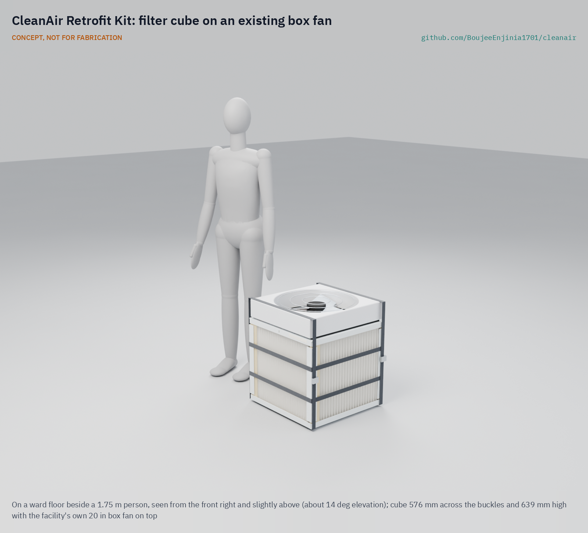
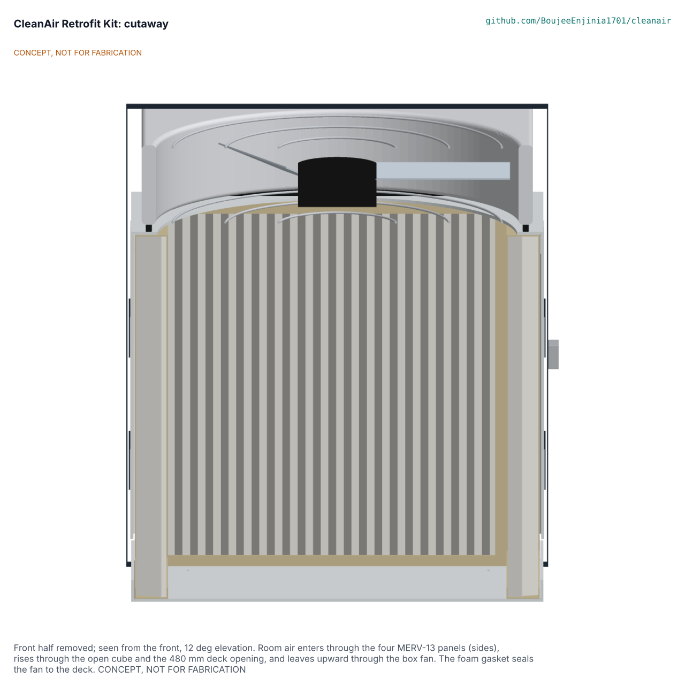
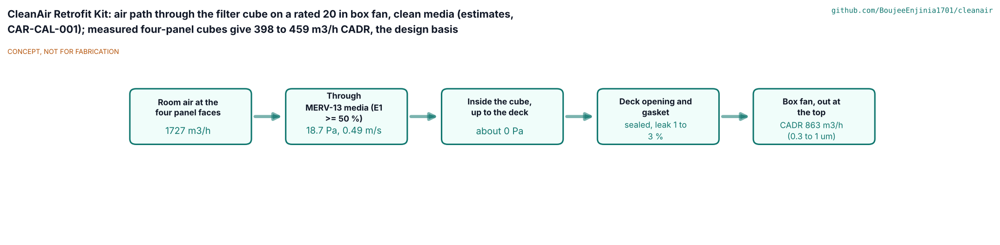
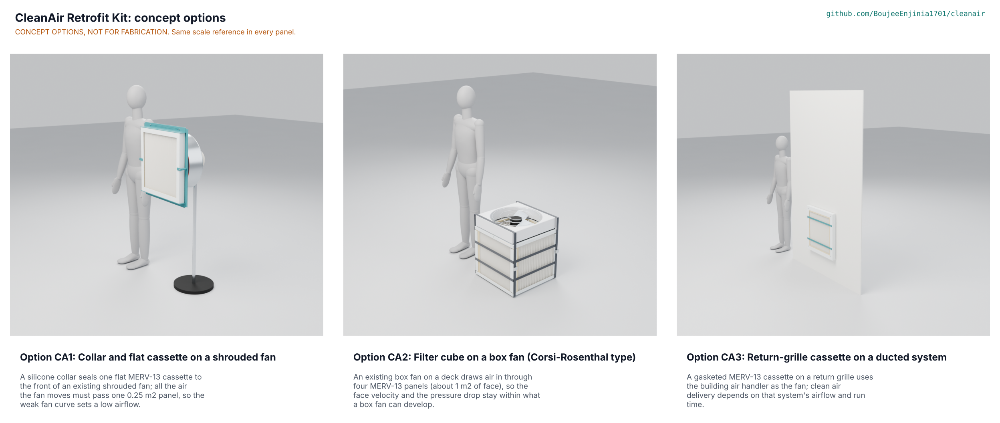
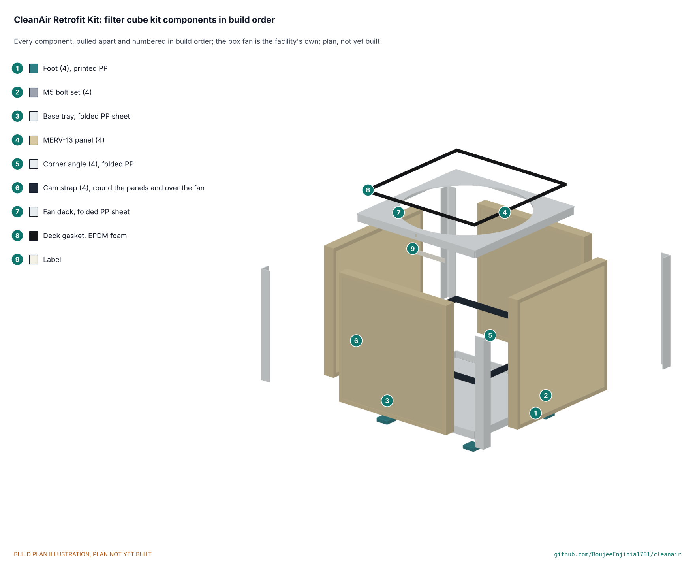

# CleanAir Retrofit Kit



CONCEPT, NOT FOR FABRICATION. [Studio view](media/render-studio.png) · [Exploded render](media/render-exploded.png) · [Concept render](media/hero.png)

    [](https://github.com/BoujeeEnjinia1701/cleanair/actions/workflows/reuse.yml)

**Area:** Healthcare and emergency response · **TRL:** 3 of 9 (proof of concept on paper; stage P3) · **Value-engineering target:** USD 150 per kit (estimate USD 111.83, fan excluded) · **Difficulty:** 2 of 5 · **Partner:** Helpful Engineering

An open, tool-free kit that turns a fan a facility already has into a room air cleaner: four standard MERV-13 panels, a scored and folded polypropylene tray and fan deck, a foam seal and four straps. Designed to reduce airborne particles in field hospitals, shelters and clinics where new HVAC is not feasible; it complements ventilation and never replaces it. The choice between this filter cube (CA2) and the team's collar and cassette (CA1) is **proposed, awaiting Amish**.

[Hero (concept render)](media/hero.png) · [Cutaway](media/cutaway.png) · [Exploded view](media/exploded.png) · [Air path](media/flow.png) · [Interactive 3D model](media/viewer.html) · [Concept blueprint (PDF)](media/concept-blueprint.pdf) · [General arrangement CAR-DWG-001 (PDF)](cad/drawings/CAR-DWG-001.pdf) · [Half section CAR-DWG-002 (PDF)](cad/drawings/CAR-DWG-002.pdf) · [Sizing note CAR-CAL-001](docs/04-calcs/01-sizing.md) · [STEM check](docs/01b-stem-check.md) · [Prototype build plan](docs/05-build-plan.md) · [Decisions](docs/06-design-decisions.md) · [Review](docs/REVIEW.md)

## Concept rationale

A box fan develops only about 27 to 55 Pa. Put one flat filter on its face and the fan slows to a fraction of its free air; spread the same air over four filters and it barely notices them. Published measurements make the point: one MERV-13 filter on a box fan moved 142 to 154 cfm, the same fan on a four-filter cube 443 to 500 cfm. This kit keeps the Helpful Engineering team's aim (retrofit what is on site, standard MERV-13 media, tool-free, wipe-clean, under USD 150) and builds it round that physics, as a documented, sealed and reusable version of the Corsi-Rosenthal box.

Design thesis: **enough media area for a weak fan, no tape, nothing that needs a tool.**

## Burning platform

- CDC asks operators to aim for 5 or more air changes per hour of clean air, counting filtration as equivalent ACH ([CDC](https://cdc.gov/niosh/ventilation/prevention/Aim-for-5.html), checked 2026-11-12).
- The Lancet COVID-19 Commission proposed 4 (good) and 6 (better) ACHe, or 10 and 14 L/s per person ([Lancet Commission task force, 2022](https://healthybuildings.hsph.harvard.edu/wp-content/uploads/2024/09/LANCET-November-2022-Proposed-Non-infectious-Air-Delivery-Rates-for-Reducing-Exposure-to-Airborne-Respiratory-Infectious-Diseases-3.pdf), checked 2026-11-12). For a 50 m2 ward that is 750 m3/h of clean air.
- In an EPA chamber, four-panel cubes reduced airborne MS2 virus by 97 % in 30 minutes, at a CADR of 234 cfm ([EPA ORD summary](https://today.uconn.edu/wp-content/uploads/2023/10/EPA-ORD-CR-Box-Bioaerosol-Results-embargoed-10-30-23-11am-est.pdf), checked 2026-11-12).

## Where it could be used

### By industry

| Industry | Use |
| --- | --- |
| Humanitarian response | Field hospital wards in tents, emergency shelters |
| Primary care | Clinic rooms and waiting areas without mechanical ventilation |
| Education and community | Schools, community halls and shelters that already own box fans |
| Local manufacturing | Sign and packaging shops cutting the tray and deck from corrugated PP |

### By country or region

| Country or region | Why it matters there |
| --- | --- |
| Displacement settings worldwide (UNHCR and MSF are named in the team deck as partners to explore) | Crowded, enclosed spaces with fans but no filtration |
| Wildfire-affected regions | The same cube reduces smoke particles (several of the cited CR box studies used smoke) |
| Low-income health systems | A kit at about USD 0.26 per m3/h of CADR, against about USD 0.61 for a mass-market portable air cleaner (CAR-MKT-001) |
| Hot, humid climates | Card-framed panels to check for sag (PR-017) |

## What sparked the idea

Helpful Engineering's CleanAir Retrofit Kit project proposed a clip-on filtration collar for existing fans and duct openings. Iteration 1 (a bespoke housing for HEPA-class media and an aluminium ring) was dropped on cost; iteration 2 used a silicone collar, a polypropylene snap ring, a MERV-13 cassette and an optional UV-C strip. This repo takes that work to a constructable design with Design Molecule Labs and tests its physics.

## Problem

Field hospitals, emergency shelters, clinics and communal spaces often have fans and duct openings but no filtration, and full HVAC replacement is rarely feasible; facility managers need a low-cost way to add clean air delivery, in air changes per hour, from what is already on site ([CAR-PRB-001](docs/01-problem.md)).

## Concept



The box fan sits on the deck, blowing up. It draws room air in through the four panel faces at 0.20 to 0.65 m/s and 9 to 34 Pa, up through the open cube and the 480 mm deck opening. A foam square seals the fan frame to the deck; folded flaps and corner strips close every panel edge. Measured four-panel cubes give **398 to 459 m3/h of CADR on high**: one cube gives a 60 m3 clinic room 6.6 to 7.6 eACH, and two cubes give a 150 m3 ward 5.3 to 6.1 ([CAR-PRC-001](docs/02-concept.md), [CAR-CAL-001](docs/04-calcs/01-sizing.md)).



## Concept options

Three working principles were modelled at detail level D3 and scored ([CAR-OPT-001](docs/02a-concept-options.md)): **CA2 filter cube on a box fan (185 of 245)**, CA1 the team's collar and flat cassette on a shrouded fan (170) and CA3 a return-grille cassette for ducted buildings (166). CA2 and CA1 are within 10 %, so both go to Amish without a pick. On measured data one CA1 kit gives about a third of a CA2 cube's clean air on the same fan, so a ward needs six CA1 kits against two cubes; CA1 fits more of the fans on site and changes faster.



## STEM check

[CAR-STM-001](docs/01b-stem-check.md): the filter cube sits within known science, with measured four-panel CADR as its design basis. Two details of the team concept failed and were fixed under Amish's standing instruction: a collar cannot seal to an unshrouded ceiling fan (scope now shrouded fans and duct openings), and a low-cost UV-C strip at the fan face gives about 0.003 mJ/cm2, a 1 % single-pass effect, while its LEDs reach the ACGIH eye limit in 7 to 11 minutes at 1 m (module removed). An independent reviewer agent attacked every verdict on 2026-11-12 (of 24 rows, 9 held, 14 weak, 1 refuted; 12 missed claims), which led to a third fix (hold-down straps on the fan frame, not the guard) and corrected figures. 15 rows wait for laboratory evidence; one (a 2 minute change of all four panels) goes to Amish.

## Key components

Four bought 20 x 20 x 2 in MERV-13 panels; a base tray and a fan deck, each cut, scored and folded from a 24 x 36 in sheet of 4 mm corrugated polypropylene; four folded corner strips from the offcuts; four 25 mm cam straps; an EPDM foam seal; four printed PP feet with M5 bolts; a label. Kit parts USD 111.83 ([bom/bom.csv](bom/bom.csv)); about 4.4 kg; 7.7 kg with the facility's own box fan.

## Building the prototype

The [prototype build plan](docs/05-build-plan.md) (CAR-BLD-001) shows how to cut, score and fold the tray, deck and corner strips with a knife and a straight edge, print the four feet, and assemble the cube in seven steps, each with a picture. No tape and no tools beyond a knife, a drill and a spanner for the feet. It is a plan, not yet built.



## Safety

Use only a fan listed to UL 507 or IEC 60335-2-80, with both guards in place, standing on the floor with its cord routed away from walkways. Never remove or press on a guard; the straps cross the solid fan frame. Unplug before changing panels; wear gloves and bag used panels. The cube is combustible: keep it 1 m from heaters, flames and oxygen outlets. The kit has no UV-C, ioniser or ozone source. It is not a substitute for ventilation, masks or other infection prevention and control measures.

## Claims and limits

From the claims register [CAR-CLM-001](docs/12-claims.md):

- **May say now (design intent):** designed to reduce airborne particles; uses MERV-13 media (ASHRAE 52.2) bought with that rating; targets a clean air delivery rate of 400 m3/h per cube; no UV, ioniser or ozone source.
- **Only after accredited testing:** a measured CADR for named particle sizes at a stated fan and speed; eACH for a named room; a measured bypass.
- **Never:** that it purifies or sterilises the air, kills or removes all germs or viruses, is 100 % effective, prevents infection or transmission, or is medical-grade; no claim about HEPA beyond a bought filter's stated class.
- **Limits on the product:** not a substitute for ventilation; performance falls as panels load; listed fan, guards in place, floor only.
- **Release limitation:** no prototype is used to protect occupants until its delivered airflow, seal and filtration efficiency are measured by a qualified laboratory.

## Helpful Engineering

This is a joint project of Design Molecule Labs and [Helpful Engineering](https://helpfulengineering.org), the global open engineering community. The Helpful Engineering CleanAir Retrofit Kit project team's update (problem, concept iterations 1 and 2, risks, the 60 to 90 day plan and the decision gate) is the source of this design; their concept is option CA1 here, and their plan, support needs and partners carry into [CAR-PLN-001](docs/11-plan.md).

## Repository layout

```
docs/                       controlled documents (PRB, STM, PRC, OPT, URS, PRS, RTM, CAL, BLD, DEC, REG, FEA, RSK, MKT, PLN, CLM, VER, FTO) and REVIEW.md
docs/04-calcs/              sizing.py (CAR-CAL-001), stem_check.py, results
docs/decisions/             decision records (concept selection, design for construction, STEM fixes)
docs/05-build-plan/         build plan pictures
cad/src/model.py            parametric model, options CA1 to CA3 at detail level D3 (kit 1.9)
cad/src/sheets.py           drawings CAR-DWG-001 and 002, STL export
cad/src/build_plan_media.py build plan pictures and making sketches CAR-DWG-101 to 104
cad/src/concept_media.py    hero, cutaway, exploded, flow, 3D viewer, concept blueprint
cad/src/product_model.py    appearance model and render views (for Blender)
cad/step/, cad/stl/, cad/drawings/   exports
bom/bom.csv                 priced bill of materials
.kit/                       shared documentation kit 1.9.1-he (do not edit here)
```

## Documentation

Controlled documents follow the portfolio standards in [.kit/STANDARDS.md](.kit/STANDARDS.md), including the Helpful Engineering profile (section 25). `python .kit/render.py --check` validates them, `python .kit/cad_check.py --export` runs the CAD fidelity check, `python docs/04-calcs/sizing.py` and `python docs/04-calcs/stem_check.py` rerun the calculations, and `python .kit/trace.py` regenerates the traceability matrix.

## Credits

Amish Chadha, Lillian Fernandes, Raksha Thammaiah, Ali Raza, Michael Minn and Bart Combee (Design Molecule Labs with Helpful Engineering). AI assistance (Claude) was used for research, calculations, CAD and documentation; design direction and all decisions are Amish Chadha's, recorded in [docs/06-design-decisions.md](docs/06-design-decisions.md).

## Licenses

Following the [Helpful Engineering licensing guide](https://helpfulengineering.org/licensing-guide/):

- Hardware (CAD sources, STEP, drawings, BOM, build plan pictures): CERN-OHL-P-2.0, [LICENSE-HARDWARE.txt](LICENSE-HARDWARE.txt)
- Software (calculation scripts, kit tools, web viewer): Apache-2.0, [LICENSE-SOFTWARE.txt](LICENSE-SOFTWARE.txt)
- Documentation (controlled documents, README, renders and concept pictures): CC-BY-4.0, [LICENSE-DOCUMENTATION.txt](LICENSE-DOCUMENTATION.txt)

---

Design Molecule Labs with Helpful Engineering
