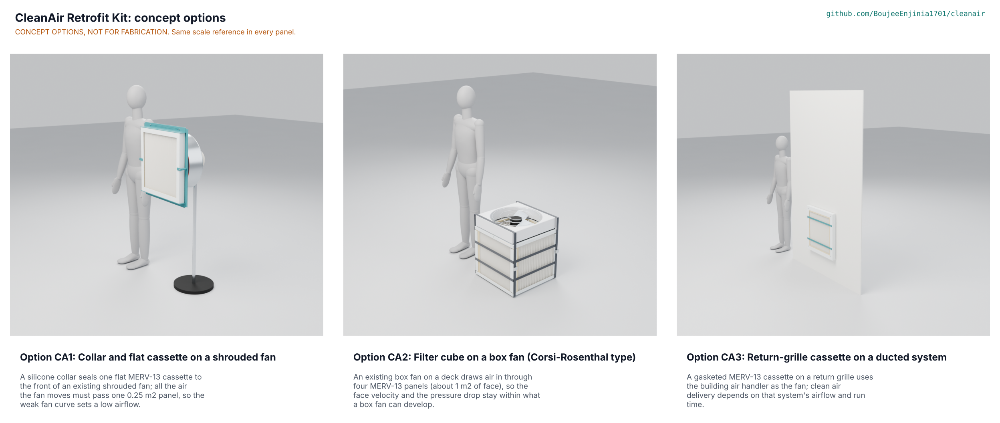

# CleanAir Retrofit Kit concept options

Result: the filter cube (CA2) scores 185 of 245, the team's collar and flat cassette (CA1) 170 and the return-grille cassette (CA3) 166. CA2 leads CA1 by 8 %, inside the 10 % band, so **both go to Amish without a pick** (STANDARDS section 21; CAR-DEC-001 D1). The engineering finding behind the gap is narrow but decisive for the main need: on the same box fan, measured data give one flat panel 29 to 35 % of the clean air of a four-panel cube (CAR-STM-001 X1). CA2 is carried in the drawing set, BOM and build plan so that a constructable design exists at TRL 3; that is not a choice. Method: STANDARDS section 21; numbers from CAR-CAL-001.

Figure 1. The three options at one scale (Blender render, to be produced from `/home/claude/he5/renderq/cleanair`).

## The options

### Option CA1: collar and flat cassette on a shrouded fan (team concept, iteration 2)

A 3 mm silicone collar sleeve stretches over the front guard rim of an existing fan (box, pedestal or wall, 12 to 24 in) and is clamped by a 25 mm tension strap; its other end grips the spigot of a PP snap-ring adaptor whose square flange carries rails, a foam gasket and one 20 x 20 x 2 in MERV-13 cassette, locked by two turn buttons. The fan blows through the panel. The team's UV-C strip and ceiling-fan scope are removed (F1, F2). Modelled at D3 with 36 parts on a 16 in pedestal fan.

### Option CA2: filter cube on a box fan (Corsi-Rosenthal type)

Four 20 x 20 x 2 in MERV-13 panels stand in a folded corrugated PP tray; a fan deck with a 480 mm opening and a foam gasket closes the top; an existing 20 in box fan on the deck draws air in through all four panels. Corner angles, four straps and four printed feet complete it. 44 parts at D3.

### Option CA3: return-grille cassette on a ducted system

A PP cassette with one MERV-13 panel, a foam gasket and four magnet cups clips onto an existing steel return grille, so the building's air handler is the fan. 26 parts at D3.

## First-order numbers

Table 1. Options compared (CAR-CAL-001, model).

| Quantity | CA1 | CA2 | CA3 |
| --- | --- | --- | --- |
| Estimated kit parts (USD, prototype) | About 60 (one panel 13.50, silicone sheet 24.59, strap 4.00, PP parts and fasteners about 18, estimate) | 111.83 (BOM) | About 70 (panel, PP frame, magnets, estimate) |
| Measured CADR, one unit, high (m3/h) | 131 to 141 (one filter on a box fan) | 398 to 459 (four-panel cubes) | Not measured; 340 to 680 while the air handler runs (model) |
| Units for 5 ACH in a 150 m3 ward | 6 | 2 | 2 to 3, if ducted |
| Media drop (Pa) | 21 to 52 | 9 to 34 | 29 to 96 (above the 25 Pa DOE optimum) |
| Bypass at 1 mm gaps | 2.5 to 8 % | 3.7 to 8.2 % | Not calculated |
| Mass of kit (kg, model) | 4.6 | 4.4 | 6.0 |
| Parts count (model) | 36 | 44 | 26 |
| Fans it fits | Any shrouded fan 12 to 24 in | 20 in box fan (cut lines for 12 and 16 in round fans) | Ducted buildings only |
| STEM check | Holds; X3, X4 fixed (F1, F2) | Holds; S18 to Amish (D3) | Holds; X12 fails (2 in panel drop) |

## Patent check (CAR-FTO-001)

CA2's four panels between a base and a cover read on the structure claimed in US 12,582,929 B2 (3M, granted 2026-03-24), whose claim 1 also requires hinged areas of the floor and ceiling turned into tabs that hold the panels. CA2 holds the panels with separate flaps, corner angles and straps and has no hinged tabs: on a desk reading that is outside claim 1, but close enough that a patent attorney must confirm before any product is made for distribution. This is not legal advice.

## Scoring

Table 2. Weighted scoring (weights: High UR 3, Medium 2, Low 1; scores 1 to 5). Maximum 245.

| Criterion | Source | Weight | CA1 | CA2 | CA3 | Reason |
| --- | --- | --- | --- | --- | --- | --- |
| Enough clean air | UR-001 | 3 | 2 | 5 | 3 | Measured 131 to 141 against 398 to 459 m3/h per unit; CA3 depends on the air handler |
| Use what is on site | UR-002 | 3 | 4 | 3 | 2 | CA1 any shrouded fan; CA2 needs a box fan (or USD 23.49 for one); CA3 needs ducts |
| Catch respiratory-size particles | UR-003 | 3 | 3 | 4 | 4 | Same media; CA1 has the larger bypass risk round odd guards |
| Quick tool-free set-up | UR-004 | 3 | 4 | 4 | 4 | All tool-free |
| Quick filter change | UR-005 | 3 | 5 | 3 | 4 | One cassette against four panels |
| No new hazard | UR-006 | 3 | 3 | 4 | 3 | CA1 runs the fan near shut-off with a sleeve on the guard; CA3 raises HVAC static |
| Stays put | UR-007 | 2 | 3 | 4 | 5 | Pedestal fan with a cassette at 1.15 m is top heavy; CA2 tips at 28 deg; CA3 on a wall |
| Know when to act | UR-008 | 2 | 3 | 3 | 2 | Label and ribbon on CA1 and CA2; CA3 hidden at a grille |
| Wipe clean | UR-009 | 2 | 4 | 4 | 4 | PP and silicone surfaces |
| Affordable kit | UR-010 | 3 | 4 | 4 | 4 | All under USD 150 |
| Standard consumables, flat pack | UR-011 | 3 | 4 | 3 | 4 | CA2 uses four panels per unit |
| Heat and humidity | UR-012 | 2 | 3 | 3 | 3 | Card frames in all |
| Tolerable noise | UR-013 | 2 | 3 | 3 | 5 | CA3 adds no fan |
| Honest and lawful | UR-014 | 3 | 4 | 4 | 4 | Same claims register |
| Low power | UR-015 | 2 | 3 | 5 | 2 | Clean air per watt: CA2 about 4, CA1 about 1.3 m3/h per W; CA3 runs an air handler |
| Fits common fans | UR-016 | 2 | 5 | 2 | 2 | CA1's main strength |
| Cost per unit of clean air | | 2 | 2 | 5 | 3 | About USD 0.43 against 0.24 to 0.28 per m3/h |
| Buildable with local skills and tools | | 2 | 3 | 5 | 3 | CA2 is knife-cut sheet; CA1 needs a moulded or printed ring 450 mm across |
| Safety | | 3 | 3 | 4 | 3 | As UR-006 and UR-007 |
| Maintenance | | 1 | 4 | 3 | 3 | One cassette against four panels |
| **Weighted total** | | | **170** | **185** | **166** | |

## Recommendation

Both CA2 and CA1 go to Amish (within 10 %), recorded as **proposed, awaiting Amish** in CAR-DEC-001 D1 and argued in CAR-DDR-001. The engineering view, for Amish to weigh: CA2 meets the main need (UR-001) with two units per ward where CA1 needs six, and costs less per unit of clean air; CA1 fits more of the fans already on site and changes faster. The runner-up's best idea, CA1's silicone collar as an adaptor for round fans on CA2's deck, is proposed as D2. CA3 is kept on file for ducted sites; it needs a 4 in panel or a second grille (X12).

Licence: this document is licensed under CC-BY-4.0 (Creative Commons Attribution 4.0 International), following the Helpful Engineering licensing guide. Design Molecule Labs with Helpful Engineering.
