# CleanAir Retrofit Kit prototype build plan

Plan, not yet built. CONCEPT, NOT FOR FABRICATION.

This plan tells a capable maker how to build the first proof-of-concept filter cube (option CA2), component by component, and shows each step in a picture. Which option goes forward is for Amish; see the design decisions register. Kit parts cost about USD 112 from the BOM; the box fan is the facility's own. Nobody relies on a prototype to protect occupants until its delivered airflow, seal and filtration efficiency are measured by a qualified laboratory.

## 1. What you are building

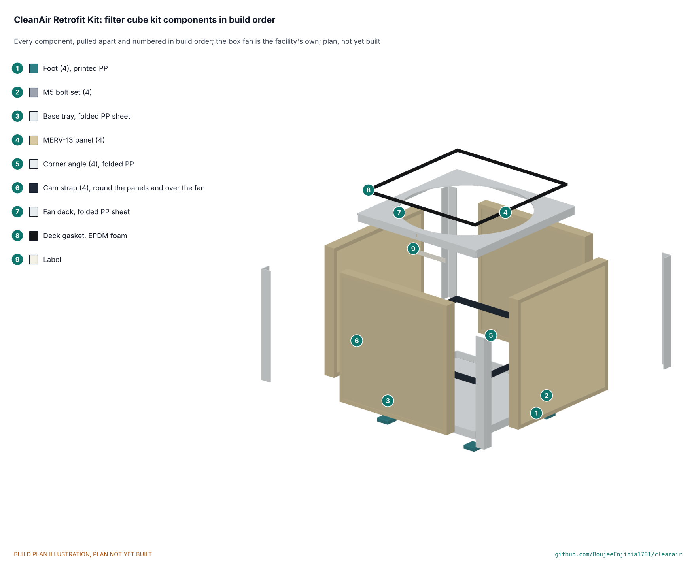

Figure 1. Components in build order.

A cube of four standard furnace-filter panels standing in a folded plastic tray, closed by a folded plastic deck with a round opening, with a 20 in box fan sitting on a foam seal on top. Four corner strips and two straps hold the panels together; two more straps hold the fan down. Four small printed feet lift the tray so the straps can pass under it. The fan pulls room air in through all four panels and blows it out of the top.

## 2. What changed to make it buildable

| What the concept had | What the constructable design has | Why |
| --- | --- | --- |
| Panels taped together (common Corsi-Rosenthal practice) | A folded tray and deck that cap the panel edges, corner strips and straps | No tape: panels change without tools and the seams stay closed |
| Fan sitting straight on the panels | A deck with a 480 mm opening and a foam seal under the fan frame | The fan's square frame corners leak and the panels' card tops are not flat |
| Straps across the fan's outlet guard | Straps across the solid fan frame, 261 mm from the centre | Strap tension could press the guard toward the blades (fix F3) |
| A tray flat on the floor | Four 15 mm feet | The hold-down straps need a path under the tray |

## 3. Making the components

### 3.1 Base tray

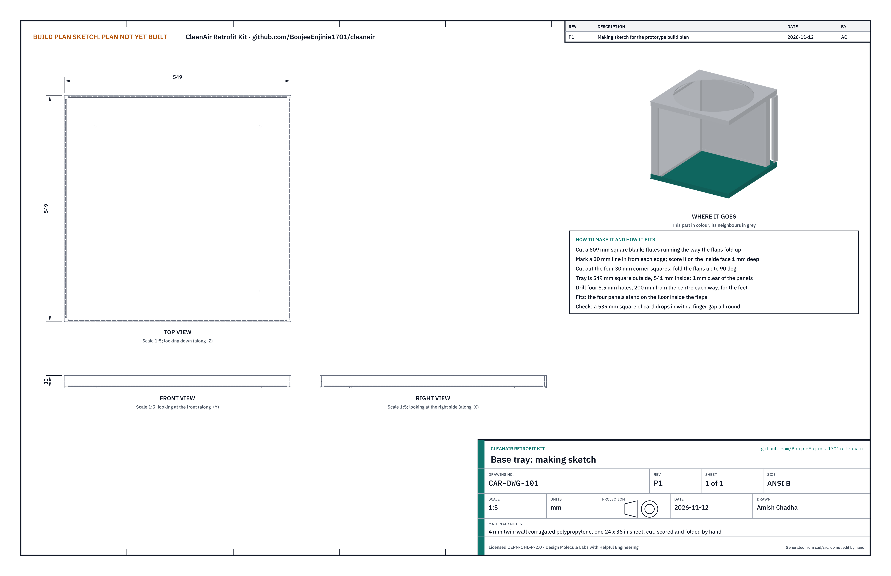

Figure 2. Base tray, making sketch CAR-DWG-101.

What it is: a shallow square tray the panels stand in, made from one 24 x 36 in sheet of 4 mm twin-wall corrugated polypropylene (sign board).

How to make it:

1. Cut a 609 mm square from the sheet with a straight edge and a sharp knife, with the flutes running in the direction the flaps will fold up.
2. Mark a line 30 mm in from each edge on the face that will be inside.
3. Score each line about 1 mm deep with the knife, through the top skin only.
4. Cut out the 30 mm square at each corner.
5. Fold the four flaps up to 90 degrees along the scores.
6. Mark and drill four 5.5 mm holes, each 200 mm from the centre along both directions.

How it fits: the four panels stand on the tray floor inside the flaps, with about 1 mm clearance; the flaps cover the bottom 26 mm of each panel's outside face. The feet bolt to the underside through the four holes.

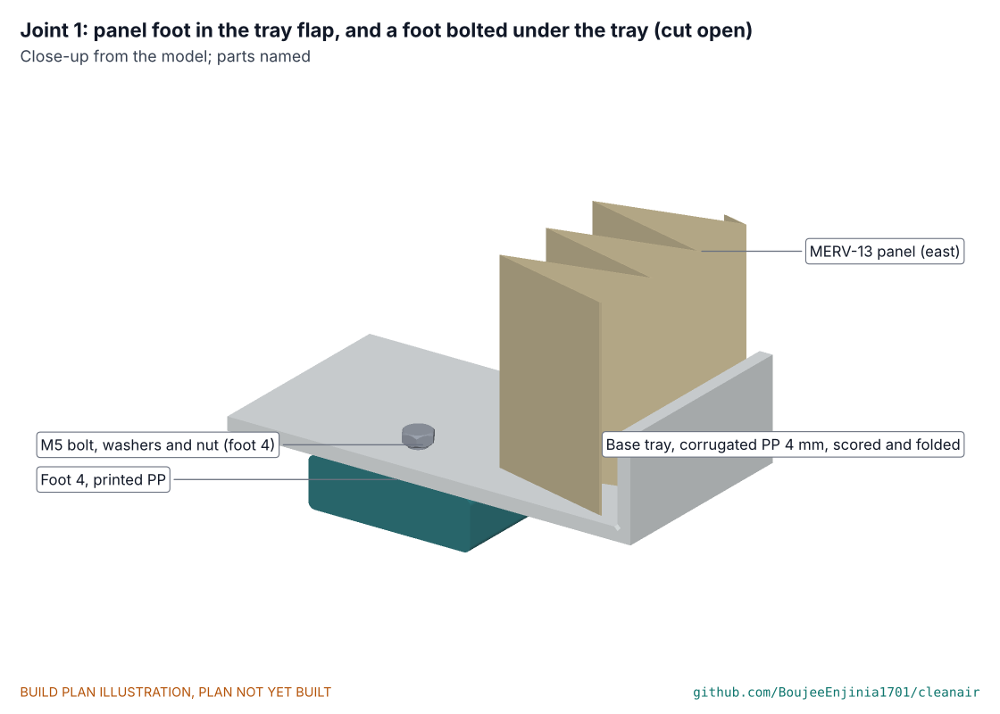

Figure 3. Joint 1.

Check before moving on: the tray is 549 mm square outside; a 539 mm square of card drops in with a finger gap all round.

### 3.2 Fan deck

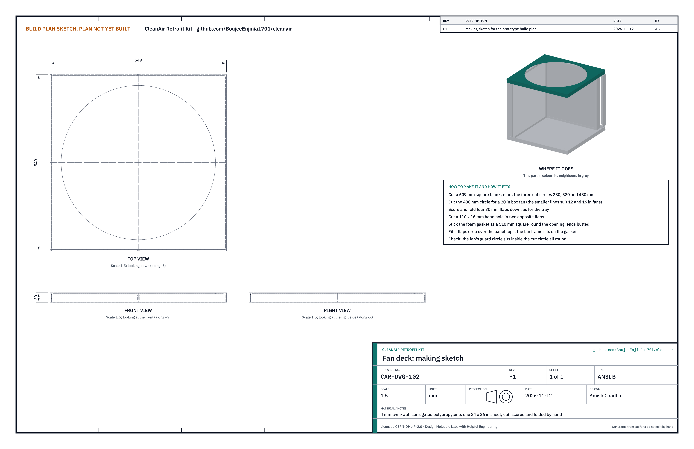

Figure 4. Fan deck, making sketch CAR-DWG-102.

What it is: the lid of the cube, from a second sheet of the same material, with a round opening under the fan's blades.

How to make it:

1. Cut a 609 mm square as for the tray.
2. Mark three circles on the centre: 280, 380 and 480 mm across. Cut the 480 mm circle for a 20 in box fan; the smaller lines are for 12 and 16 in round fans.
3. Score, cut the corners and fold four 30 mm flaps as for the tray, but fold them down.
4. Cut a 110 x 16 mm hand hole in the middle of two opposite flaps.
5. Stick the foam weatherstrip on the top face as a 510 mm square around the opening, ends butted tight.

How it fits: the flaps drop over the tops of the panels with about 1 mm clearance; the fan's frame sits on the foam square, which presses to about 10 mm.

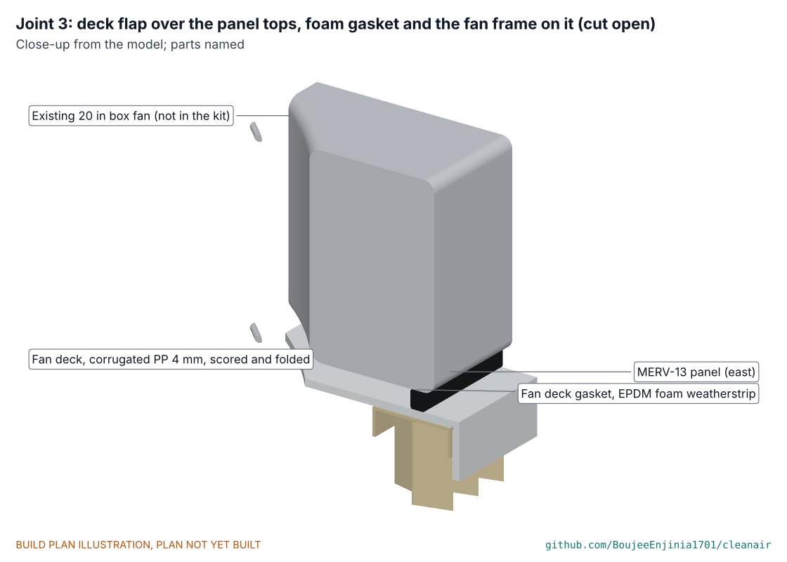

Figure 5. Joint 3.

Check before moving on: with the fan set on it, the fan's guard circle sits inside the cut opening all round and the foam touches the frame on all four sides.

### 3.3 Corner strips

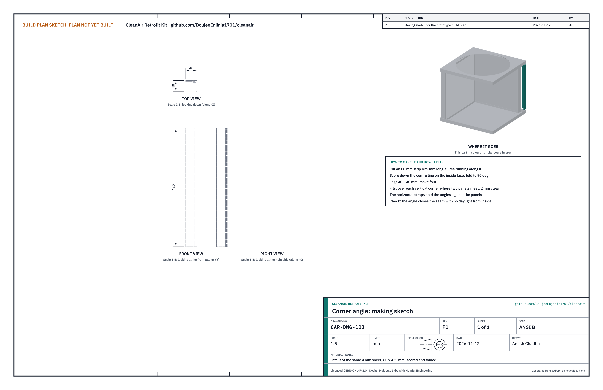

Figure 6. Corner strip, making sketch CAR-DWG-103.

What it is: four right-angle strips that cover the vertical seams where two panels meet, cut from the leftover pieces of the two sheets.

How to make it:

1. Cut four strips 80 mm wide and 425 mm long, with the flutes running along the strip.
2. Score each down its centre line on the inside face.
3. Fold to 90 degrees, giving two 40 mm legs.

How it fits: each strip sits over a vertical corner, about 2 mm clear of the panels, between the tray flaps and the deck flaps. The two horizontal straps press it on.

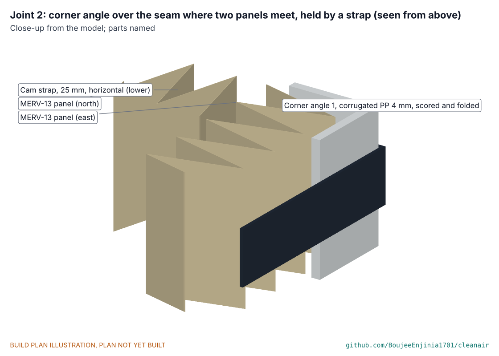

Figure 7. Joint 2.

Check before moving on: looking from inside the cube toward a light, no daylight shows along the seam.

### 3.4 Feet

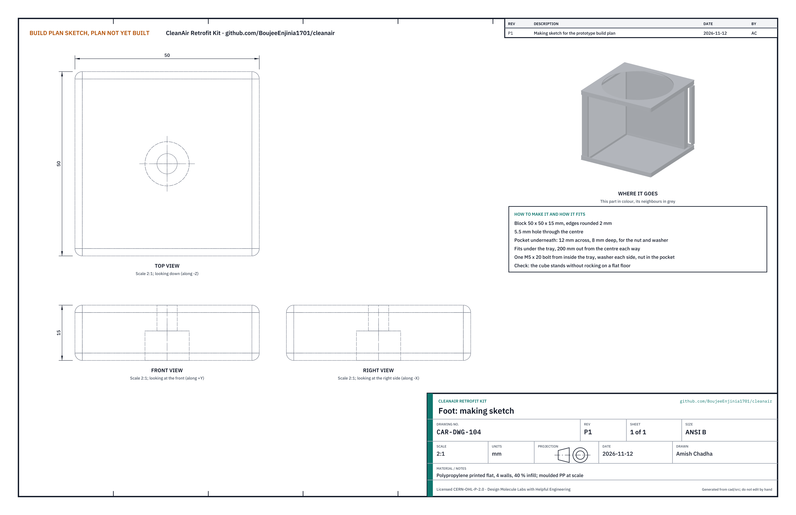

Figure 8. Foot, making sketch CAR-DWG-104.

What it is: four small polypropylene blocks, 50 x 50 x 15 mm, printed flat with four walls and 40 % infill (moulded at scale).

How to make it: print with a 5.5 mm hole through the centre and a pocket 12 mm across and 8 mm deep in the underside for the nut and washer; round the edges about 2 mm.

How it fits: one M5 x 20 bolt goes down through the tray floor from inside, a washer under its head, through the foot, and a washer and nut in the pocket.

Check before moving on: the four feet stand level on a flat floor.

### 3.5 Bought components

- **MERV-13 panels (4):** 20 x 20 x 2 in nominal, MERV 13 to ASHRAE 52.2 on the supplier's report, synthetic pleated media; check the actual size (about 495 x 495 x 44 mm) before cutting the tray. Do not cut or tape the panels.
- **Cam straps (4):** 25 mm webbing, 2.4 m long, with a cam or thumb-release buckle. Trim the spare tail after the first fitting, leaving 150 mm.
- **Foam weatherstrip:** EPDM closed-cell, 8 x 14 mm, self-adhesive, 3 m roll; 2.04 m is used.
- **M5 bolt sets (4):** M5 x 20 hex bolt, two washers, nut.
- **Label:** printed vinyl, 150 x 18 mm, with the airflow arrow, the change interval and the warnings in section 6.
- **Box fan:** the facility's own 20 in box fan, listed to UL 507 or IEC 60335-2-80 and with both guards in place. It is not part of the kit.

## 4. Putting it together

### Step 1: bolt the feet under the tray

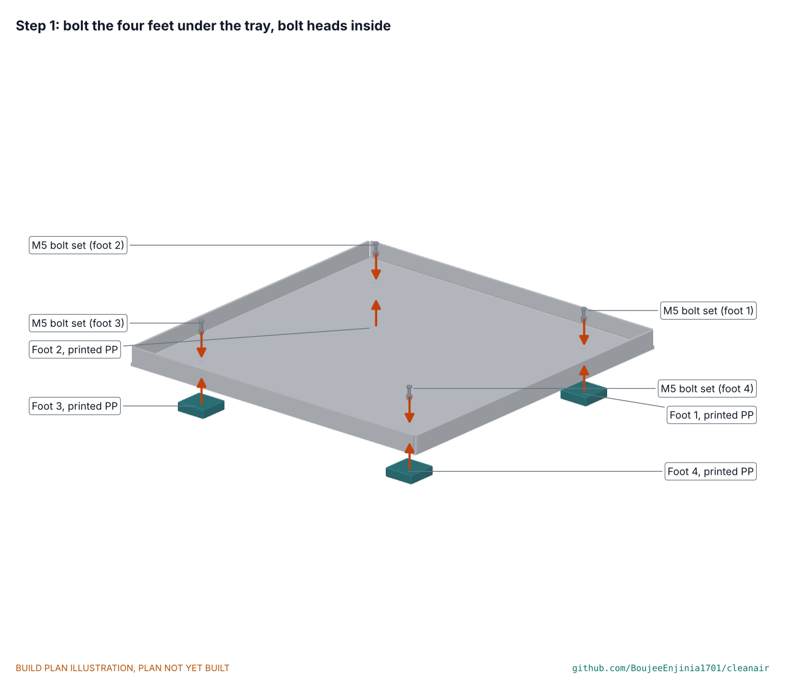

Figure 9. Step 1.

Push each bolt down from inside the tray, through the foot, and tighten the nut in the pocket by hand plus a quarter turn with a spanner; the tray must not crush.

### Step 2: stand the panels in the tray

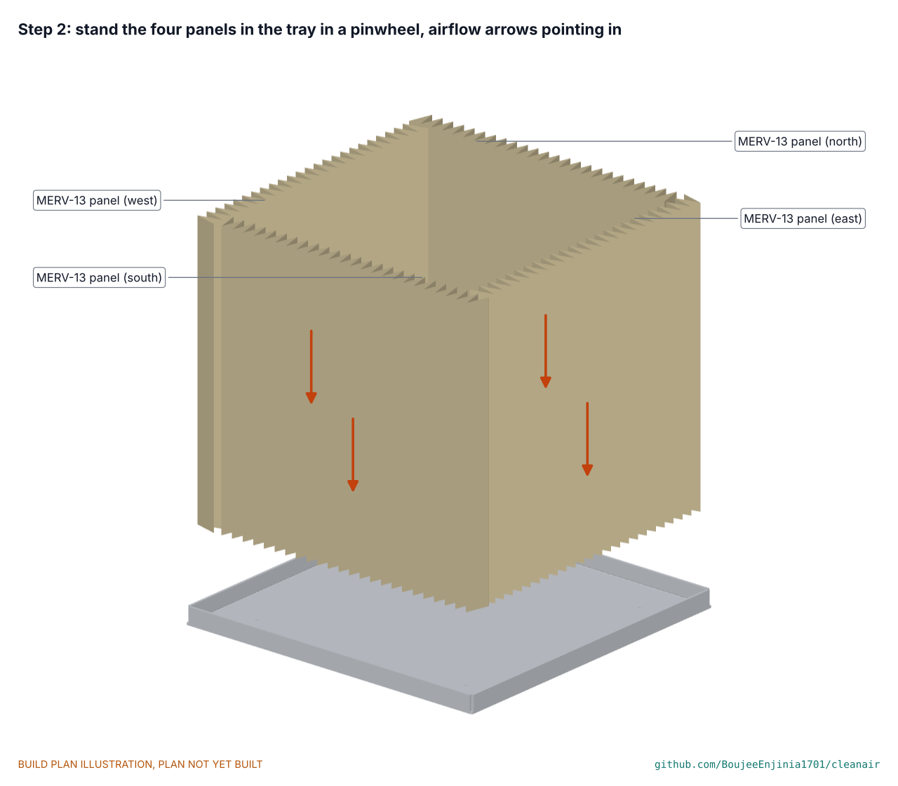

Figure 10. Step 2.

Stand the four panels on the tray floor in a pinwheel: each panel's end butts against the face of the next. Every printed airflow arrow points into the cube.

### Step 3: fit the corner strips

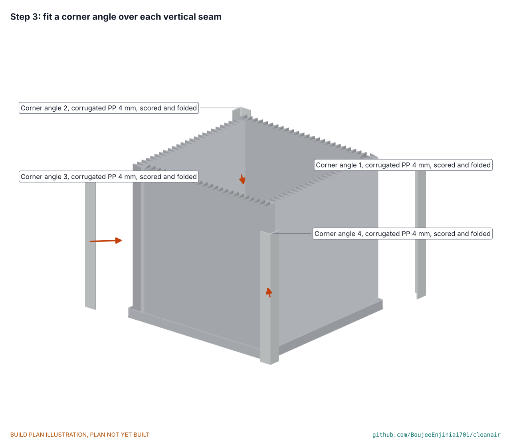

Figure 11. Step 3.

Hold a strip over each vertical corner, between the tray flaps and where the deck flaps will come.

### Step 4: strap the panels

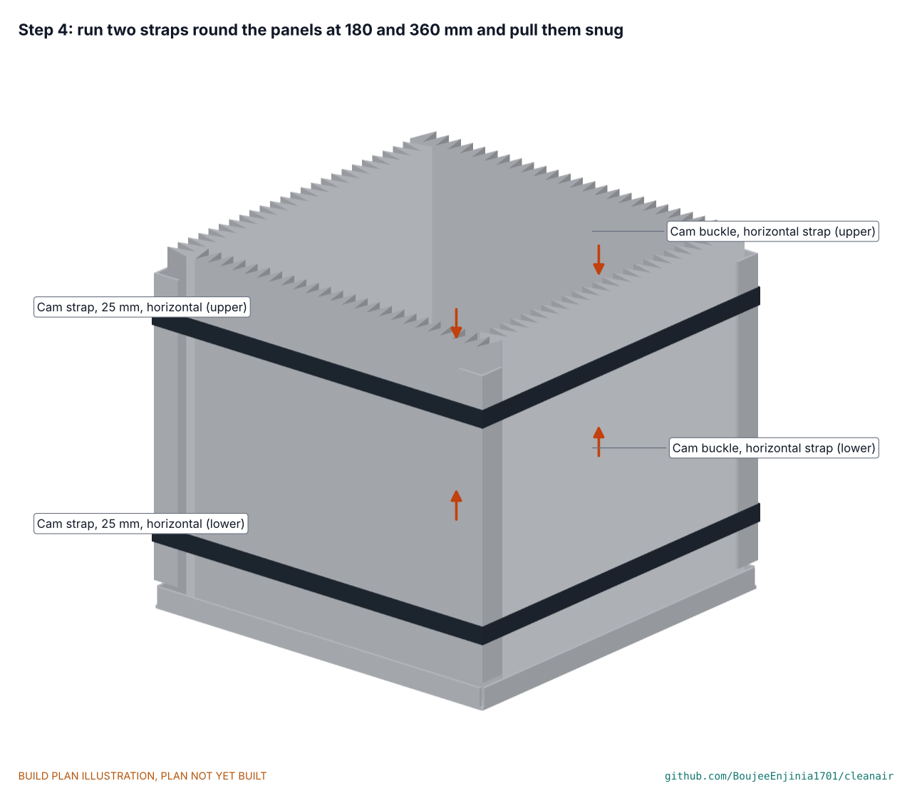

Figure 12. Step 4.

Run one strap round the panels at about 180 mm from the floor and one at about 360 mm, over the corner strips, buckles on the same side. Pull them snug, not tight: the card frames must not bow.

### Step 5: fit the deck

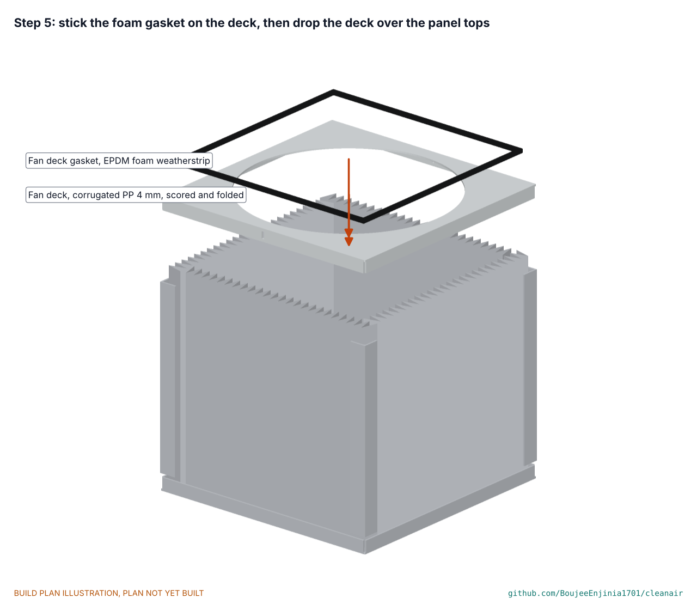

Figure 13. Step 5.

With the foam square already on it, drop the deck over the panel tops so its flaps cover the top edges all round.

### Step 6: set the fan on the deck

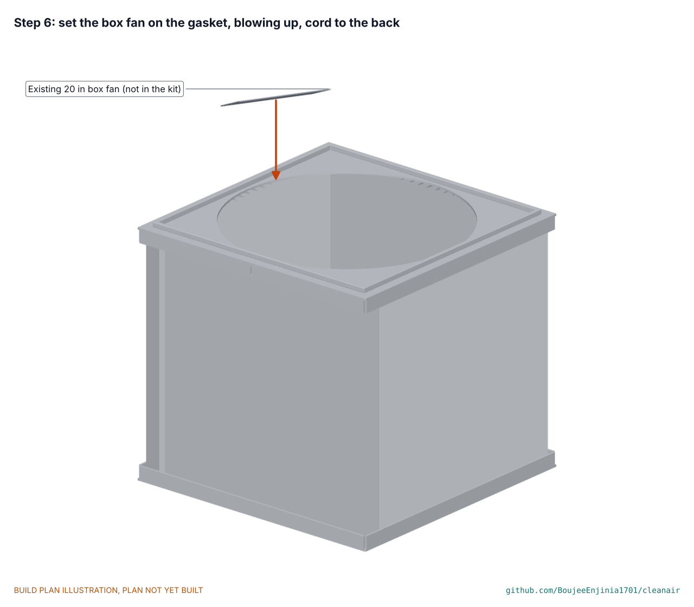

Figure 14. Step 6.

Unplug the fan. Lay it on the foam, blowing up (the airflow arrow on the fan pointing up), centred over the opening, cord to the back.

### Step 7: hold the fan down and fit the label

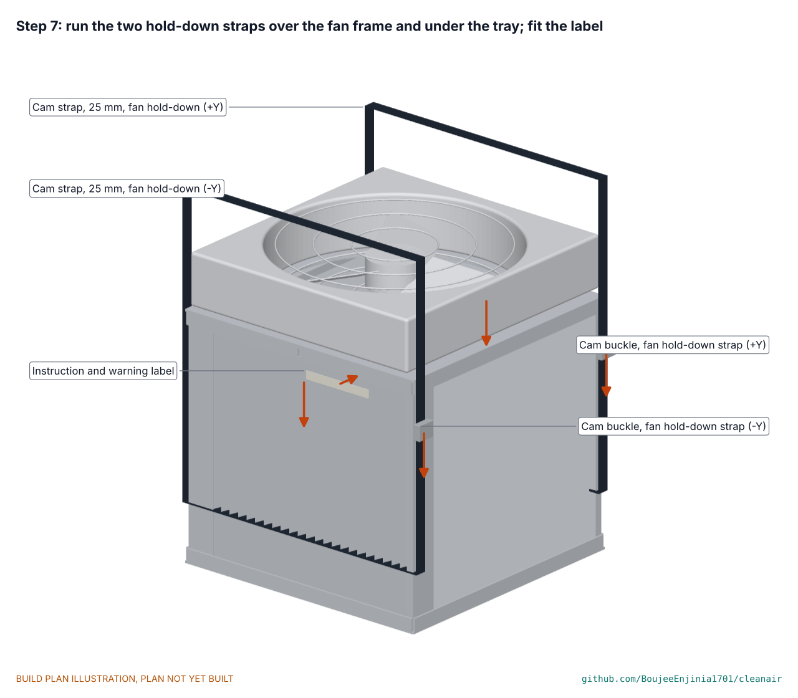

Figure 15. Step 7.

Run the two remaining straps over the solid frame of the fan, never across its grille, down the outside and under the tray between the feet. Pull them until the foam is pressed evenly. Stick the label on the front deck flap.

## 5. First checks

These are listed here and recorded in a TRL 4 test report, not in this plan.

| Check | Requirement | Pass criterion |
| --- | --- | --- |
| Panels and seams: no daylight along any seam from inside | PR-006 | No visible gap over 1 mm |
| Fan seal: a ribbon or tissue held at the deck edge with the fan on | PR-006 | No inflow along the deck edge or the fan frame |
| Stability: tilt the cube with its fan to 10 deg | PR-012 | It returns upright |
| Assembly time from a flat pack, by someone new to it | PR-007 | 15 minutes or less, no tools |
| Panel change time, one panel and the full set | PR-008 | Recorded against the filter-change target |
| Guards: nothing touches either fan guard | PR-011 | No contact |
| Airflow and CADR at a laboratory | PR-001 | 400 m3/h or more for 0.3 to 1 um |

## 6. Safety stops

- **Before first power:** the fan is listed, both guards are in place, the cord is undamaged and routed away from walkways, and no strap or tape is within reach of the blades. Stop if not.
- **Before leaving it running:** it stands on the floor, not a table, at least 1 m from heaters, flames and oxygen outlets, with 300 mm clear around the panel sides.
- **Before a panel change:** unplug the fan; wear gloves; bag used panels at the cube.
- **Before use with occupants:** no prototype is relied on until its delivered airflow, seal and filtration efficiency are measured by a qualified laboratory.

## 7. Tools, skills and workspace

A straight edge, a tape measure, a sharp utility knife, a marker, a drill with a 5.5 mm bit, a 8 mm spanner, and access to a 3D printer for the feet. A clear table 1 m square. Skills: careful marking and cutting; no power tools beyond a drill.

## 8. Where the numbers come from

- Model: `cad/src/model.py` (option CA2), checked by `cad/fidelity.json`; STEP files in `cad/step/CA2/`.
- Drawings: `cad/drawings/CAR-DWG-001` (general arrangement), `CAR-DWG-002` (half section), `CAR-DWG-101` to `104` (making sketches).
- Calculation note: `docs/04-calcs/01-sizing.md` (CAR-CAL-001).
- BOM: `bom/bom.csv`.
- Pictures: `cad/src/build_plan_media.py`.

Licence: this document is licensed under CC-BY-4.0 (Creative Commons Attribution 4.0 International), following the Helpful Engineering licensing guide. Design Molecule Labs with Helpful Engineering.
